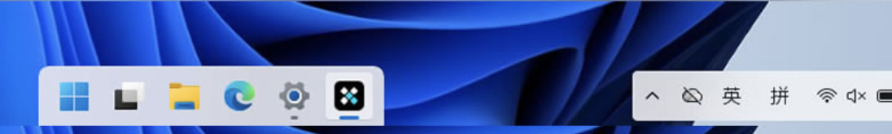
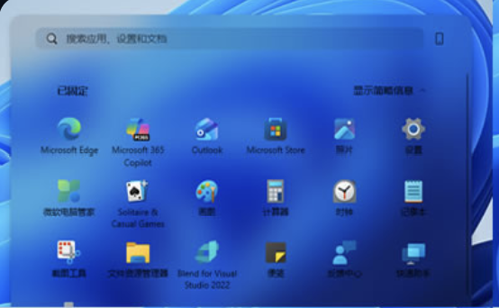

# Desk 开发计划

> 版本：v0.2 · 日期：2026-10-29 · 状态：**已确认，开始开发 v0.1**（决策见第 10 节）
>
> Desk 是暂定名（取自仓库名）。目标是做一个属于自己的 Windows 11 桌面美化工具。
> 第一阶段只做两件事：**浮岛式任务栏**（图一）和**实时模糊的开始菜单**（图二）。

---

## 0. 结论

1. **图一、图二都是改造原生界面，不需要另造一个。** Windows 11 的任务栏和开始菜单都是 XAML 界面。
   目前最成熟的做法来自 TranslucentTB 和 Windhawk 的 Taskbar Styler / Start Menu Styler：
   借助微软公开的 XAML 诊断接口 `InitializeXamlDiagnosticsEx` 接入
   `explorer.exe` / `StartMenuExperienceHost.exe` 的界面，直接修改控件的背景、圆角和边距等属性。
   这样做出来的效果是原生级的，圆角有抗锯齿，模糊强度也能调。托盘、输入法"英/拼"、
   音量/网络弹窗、跳转列表和拖放这些原生功能都不受影响。
2. **推荐架构：** `Desk.exe` 负责常驻托盘和设置界面（C#），`DeskTap.dll` 是加载进系统进程的
   样式引擎（C++），外观由主题文件描述（JSON，写成"选择器 → 属性"规则）。
3. **不建议一开始就自己重画任务栏和开始菜单**（Seelen UI 走的是这条路）。这样工作量要大一个数量级，
   托盘、输入法指示器和各种系统弹窗都得重做，日常用起来反而容易变差。
4. **先用现成工具把样子定下来（Phase 0，不用写代码）。** 用 Windhawk 加 Taskbar Styler 和
   Start Menu Styler，现在就能调出接近图一、图二的效果。你先在自己电脑上调到满意并截图，
   这些截图就作为自研引擎的验收标准。
5. **说句实话：** 如果只是想要好看，做完 Phase 0 就够了。自研值得做的理由有这几条：
   一体化、开箱即用，有自己的设计语言，能把现成工具里分散的功能组合起来（见第 4 节），
   而且整个工具完全由你掌控。

---

## 1. 需求拆解

### 1.1 图一：浮岛式任务栏



截图里能看出这些特征：

- 任务栏不再是横贯屏幕底部的一整条，而是拆成两个独立的圆角"浮岛"：
  - 左侧**应用岛**：开始、任务视图、资源管理器、Edge、设置等，宽度随图标数量变化；
  - 右侧**托盘岛**：`^`、OneDrive、`英`/`拼` 输入法、Wi-Fi、音量、电池。
- 岛和岛之间、岛和屏幕边缘之间都露出壁纸，看上去遮挡少。
- 用的是浅色半透明材质，原生的运行指示条（图标下的小横线）还保留着。

要做的事：去掉整条背景，给两个岛分别加背景、圆角和描边，让岛的宽度跟着内容变，再把岛之间的空白区域处理好。

> 已确认：**应用岛放在屏幕中间**（与图一的靠左不同），托盘岛在右侧。

### 1.2 图二：实时模糊的开始菜单



- 这是 2025 年 10–11 月开始推送的**新版开始菜单**，适用于 24H2/25H2，从 KB5067036 起提供。
  它的搜索框右侧有"手机连接"按钮，固定区可以展开或收起。
- 背景做了实时模糊，能透出后面的壁纸和窗口，比系统默认的更通透。

要做的事：替换开始菜单的背景材质（模糊强度、着色和透明度都能调），统一圆角和描边，
并和任务栏用同一套材质。

### 1.3 第一阶段不做的事

- 不重写任务栏和开始菜单本身，原生功能全部保留。
- 只支持 Windows 11 24H2 及以上，不做 Windows 10。
- 平铺窗口管理、桌面小组件、动态壁纸、自研启动器都放到"后续扩展"里。

---

## 2. GitHub 调研

### 2.1 相关项目

**A. 改造原生任务栏和开始菜单**（和我们的目标最接近）

| 项目 | 做法 | 许可证 | 我们借鉴什么 |
|---|---|---|---|
| [Windhawk](https://github.com/ramensoftware/windhawk) + [Windows 11 Taskbar Styler](https://github.com/ramensoftware/windhawk-mods/blob/main/mods/windows-11-taskbar-styler.wh.cpp) | 模组注入 explorer 后，通过 XAML 诊断按"选择器 → 属性"修改任务栏控件。社区有 40 多个主题（DockLike、Pills、FrostyGlass、LiquidGlass 等），自带可调模糊半径的 `WindhawkBlur` 画刷。它的"点击穿透"选项用 `SetWindowRgn` 把空白区域裁掉。目前仍在活跃更新（Styler v1.10） | GPL-3.0 | **主要参考**：主题语法、元素名、模糊画刷、点击穿透 |
| [Windows 11 Start Menu Styler](https://github.com/ramensoftware/windhawk-mods/blob/main/mods/windows-11-start-menu-styler.wh.cpp) | 用同样的方式注入 `StartMenuExperienceHost.exe` 和 `SearchHost.exe`。已经有专门适配新版开始菜单的玻璃主题（FrostyGlass、WindowGlass、Fluid、LiquidGlass）。搜索结果区是 WebView，要用 CSS 改（v1.7） | GPL-3.0 | 开始菜单的元素名（如 `Border#AcrylicBorder`）和换材质的方法 |
| [TranslucentTB](https://github.com/TranslucentTB/TranslucentTB) | 让任务栏透明、模糊或变成亚克力，能在"有最大化窗口""开始菜单打开"等情况下切换外观。在 Win11 上靠 [ExplorerTAP](https://github.com/TranslucentTB/TranslucentTB/tree/develop/ExplorerTAP)（XAML 诊断）实现，2026 年仍在发版 | GPL-3.0 | 独立程序做注入的最小实现。Windhawk 的控件树监听和模糊画刷都是从这里演化来的 |
| [RoundedTB](https://github.com/torchgm/RoundedTB) | 从外部裁剪任务栏窗口的形状，实现圆角、边距和动态宽度。项目已于 2023-09 归档 | GPL-3.0 | 只参考思路。官方说明里写了圆角做不了抗锯齿，配合透明效果时会闪烁 |
| [Taskbar auto-hide when maximized](https://github.com/ramensoftware/windhawk-mods/blob/main/mods/taskbar-auto-hide-when-maximized.wh.cpp) / [Taskbar Background Helper](https://github.com/ramensoftware/windhawk-mods/blob/main/mods/taskbar-background-helper.wh.cpp) | 前者只在窗口最大化或压到任务栏时才自动隐藏；后者在有最大化窗口时给透明部分补上背景 | GPL-3.0 | "最大化感知"的交互设计 |
| [SmartTaskbar](https://github.com/ChanpleCai/SmartTaskbar) | 不做注入，从外部切换任务栏的自动隐藏状态。README 里说明多显示器下有问题 | MIT | 不注入时的实现方式 |

**B. 自己重画一套，替代原生界面**

| 项目 | 做法 | 许可证 | 我们借鉴什么 |
|---|---|---|---|
| [Seelen UI](https://github.com/eythaann/Seelen-UI) | 一整套桌面环境，包括工具栏、Dock、启动器、平铺窗口管理和壁纸，用 CSS 做主题。技术栈是 Rust + Tauri，约 1.8 万星 | AGPL-3.0 | 以后要自绘 Dock 时，可以参考它的整体架构 |
| [ManagedShell](https://github.com/cairoshell/ManagedShell) + [RetroBar](https://github.com/dremin/RetroBar) | .NET 写的外壳库，加上基于它的经典任务栏替代品。托盘的做法是自己注册一个 `Shell_TrayWnd` 窗口截获图标消息，再转发给 Explorer | Apache-2.0 | 自绘任务栏时，任务列表和托盘可以照它的方式实现 |
| [YASB](https://github.com/amnweb/yasb) / [Zebar](https://github.com/glzr-io/zebar) | 可定制的状态栏（YASB 用 Python + Qt，Zebar 用 Tauri） | MIT / GPL-3.0 | 用 CSS 做主题的思路 |

**C. 开始菜单和启动器的替代品**

| 项目 | 做法 | 许可证 | 我们借鉴什么 |
|---|---|---|---|
| [Flow Launcher](https://github.com/Flow-Launcher/Flow.Launcher) | 快速启动器，支持拼音搜索，从 v1.20 起改用系统 DWM 做模糊 | MIT | 以后自研启动器时参考：拼音搜索、模糊窗口 |
| [Open-Shell](https://github.com/Open-Shell/Open-Shell-Menu) | 经典风格的开始菜单替代品 | MIT | 接管 Win 键和开始按钮的方法 |

**D. 其他毛玻璃工具**（后续扩展时用）

| 项目 | 做法 | 许可证 |
|---|---|---|
| [DWMBlurGlass](https://github.com/Maplespe/DWMBlurGlass) | Hook DWM，给窗口标题栏加模糊或 Aero 效果 | GPL-3.0 |
| [ExplorerBlurMica](https://github.com/Maplespe/ExplorerBlurMica) | 给资源管理器加模糊、亚克力或 Mica | LGPL-3.0 |
| [TranslucentFlyouts](https://github.com/ALTaleX531/TranslucentFlyouts) | 让右键菜单和弹出菜单半透明 | GPL-3.0 |
| [WPF-UI](https://github.com/lepoco/wpfui) / [window-vibrancy](https://github.com/tauri-apps/window-vibrancy) | 给自己的窗口加上 Mica 或 Acrylic 背景 | MIT / MIT + Apache-2.0 |

### 2.2 关键发现

1. **Win11 的任务栏和开始菜单都是 XAML 界面**，改它们最好的手段就是 XAML 诊断接口。
   这是微软为 Visual Studio"实时可视化树"这类开发工具准备的
   [公开 API](https://learn.microsoft.com/windows/win32/api/xamlom/nf-xamlom-initializexamldiagnosticsex)，
   比传统的远程线程注入更正规。TranslucentTB 和 Windhawk 都已经用了好几年。
2. **同一个进程同一时间只能有一个 XAML 诊断使用者**（Windhawk 文档原话）。因此我们的工具不能和
   Windhawk Styler、TranslucentTB 或 ExplorerBlurMica 同时改同一个进程，需要检测到冲突并提示用户。
3. **系统自带的 AcrylicBrush 模糊强度是固定的**，有多个任务栏（多显示器）时还不稳定。想让模糊强度可调，
   就得自己写 Composition 画刷，流程是 `BackdropBrush` → `GaussianBlurEffect` → 叠加着色层。
   TranslucentTB 的 [`XamlBlurBrush`](https://github.com/TranslucentTB/TranslucentTB/blob/develop/ExplorerTAP/XamlBlurBrush.cpp)
   就是这样实现的，Windhawk 的 `WindhawkBlur` 也基于它。另外，Mica 材质用这种方式目前还做不到。
4. **从外部裁剪窗口形状（RoundedTB 的做法）不适合用来做外观**：圆角有锯齿，还会闪烁，项目也已经归档了。
   不过 `SetWindowRgn` 还有一个用处：让岛与岛之间的空白区域可以点击穿透。外观部分交给 XAML 处理。
5. **自己重画任务栏，最难的是托盘**：得像 ManagedShell 那样冒充 `Shell_TrayWnd` 截获图标消息，
   再转发给 Explorer。而 Win11 的网络、音量、电池和输入法指示器根本不是普通的托盘图标，
   必须全部自己重做。这是不推荐走自绘路线的主要原因。
6. **系统本身也在变**：2025 年底推出的新版开始菜单，控件结构和旧版不一样，样式规则要分别适配。
   据 2026 年的报道，26H2 恢复了把任务栏放到顶部或左右两侧的选项，还新增了"任务栏大小"
   （小任务栏）设置。我们的规则需要能区分这些状态。任务栏高度可以直接交给系统的小任务栏选项。

---

## 3. 三条技术路线对比

| | A. 从外部改窗口形状 | **B. 注入后改 XAML 样式（推荐）** | C. 自己重画替代 |
|---|---|---|---|
| 代表项目 | RoundedTB | TranslucentTB、Windhawk Styler | Seelen UI、RetroBar |
| 视觉质量 | 圆角有锯齿、容易闪烁，做不了描边和阴影 | 原生级：圆角有抗锯齿，模糊可调，能加描边 | 完全自由，动画和图标放大都能做 |
| 原生功能 | 全部保留 | 全部保留 | 托盘、输入法、系统弹窗、跳转列表、缩略图等都要重做 |
| 开发量 | 小 | 中 | 很大 |
| Windows 更新后 | 偶尔失效 | 元素名可能变化，改主题文件就能修好 | 基本不受影响 |
| 资源占用 | 极低 | 极低 | 中到高（用 WebView 的方案更高） |
| 主要风险 | 能做到的效果有限 | 可能被杀毒软件误报，引擎崩溃时 explorer 会跟着重启 | 功能缺口会影响日常使用 |

**结论：**

- 主线走路线 B。路线 A 只借用"点击穿透"这一招。路线 C 留作远期选项，比如以后想要 macOS 那种图标放大的 Dock。
- 如果想最省事，还有个折中办法：把 Desk 做成"Windhawk 主题 + 自定义模组"，不单独发布。
  这样开发量最小，代价是离不开 Windhawk。

---

## 4. 对这两点的改进建议

### 4.1 任务栏

1. **空白处点击穿透**：岛之间和岛两侧的空白区域不只是看起来透明，鼠标也能直接点到下面的桌面图标和窗口，
   "遮挡少"就从视觉上的变成了实际可用的。Windhawk 有同名选项，说明这个做法可行。
2. **最大化感知**（设置里三选一）：
   - **融合**：有窗口最大化时，两个岛合并成贴边的一整条，最大化窗口下面就不会露出一截奇怪的缝；
   - **智能隐藏**：只有在窗口最大化或压到任务栏时才自动隐藏，平时保持浮岛。这是遮挡最少的方案，笔记本小屏幕推荐用它；
   - **保持不变**。
3. **宽度平滑过渡**：打开或关闭程序时，应用岛的宽度用 150–200ms 的动画过渡，不要直接跳变。
4. **细描边加极淡的阴影**：加 1px 半透明描边（深色模式偏亮，浅色模式偏暗），壁纸再花，岛的边界也能看清。
5. **把时钟放回托盘岛**：图一里看不到时钟，建议保留。可以只显示时间、不显示日期，保持紧凑。
6. **配合系统的小任务栏**：如果你的系统已经有"任务栏大小"选项，直接用它来降低高度，比我们自己改高度更稳定。
7. **可选布局**：靠左两岛（图一，默认）、居中的 Dock 式单岛，或者三岛（开始和固定图标 · 运行中的程序 · 托盘）。

### 4.2 开始菜单

1. **模糊强度可调，着色自适应**：同一张壁纸在浅色和深色模式下、亮处和暗处，可读性差别很大。
   建议根据壁纸亮度自动调整着色透明度，让文字对比度保持在 4.5:1 以上，不要用一个固定的透明度。
2. **加约 2% 的噪点**：大面积模糊容易出现色带，微软的亚克力材质也是靠噪点解决这个问题的。
3. **和任务栏用同一套"设计令牌"**：圆角、模糊、着色和描边只定义一次，任务栏的岛和开始菜单都引用它
   （以后还可以用到音量和语言弹窗、Alt+Tab 上），整体才会像一套设计。
4. **对齐浮岛**（视实现难度而定）：让开始菜单的左边缘和应用岛的左边缘对齐，间距也保持一致，
   看起来就像从岛里"长"出来的。
5. **节能模式自动降级**：笔记本开启节能模式时，自动换成纯色或低模糊，省电。
6. **远期**：如果想要原生开始菜单做不到的功能，比如**拼音和首字母搜索**（输入 `wx` 就能找到"微信"）
   或用 Everything 秒搜文件，再考虑自研启动器，可以参考 Flow Launcher。

### 4.3 初始设计参数（在 Phase 0 里再微调）

| 参数 | 建议初值 |
|---|---|
| 圆角 | 8px（与 Win11 窗口一致），想更圆润可以用 12px |
| 岛与屏幕边缘、岛与岛之间的间距 | 6–8px |
| 模糊强度 | 任务栏 20–25，开始菜单 30 |
| 浅色着色 | `#F3F3F3`，任务栏 70% 不透明，开始菜单 55% |
| 深色着色 | `#202020`，任务栏 65% 不透明，开始菜单 50% |
| 描边 | 1px，浅色模式用约 6% 的黑，深色模式用约 10% 的白 |
| 噪点 | 2% |

---

## 5. 总体架构

```
Desk.exe（C# / .NET 10 / WPF，常驻托盘的普通进程）
│  · 设置界面、主题管理、开机自启、日志、安全模式、一键还原热键
│  · 状态检测：最大化窗口（WinEvent 钩子）、节能模式、深浅色、壁纸亮度
│  · 注入器：监视下面两个进程的启动与重启，随时重新加载 DLL
│  · 读取主题文件 themes/*.json（选择器 + 属性 + 状态）
│
│  InitializeXamlDiagnosticsEx 加载 DLL；命名管道推送主题和状态（默认 / 最大化 / 节能）
│
├──► explorer.exe（任务栏）
│      └─ DeskTap.dll（C++/WinRT）
│           · 监听控件树 → 匹配规则 → 改属性
│           · DeskBlur 模糊画刷、点击穿透区域
│           · 记录原值，退出时完整还原
│
└──► StartMenuExperienceHost.exe（开始菜单）
       └─ DeskTap.dll（同一个 DLL）
            · 替换 AcrylicBorder 等元素的材质、圆角、描边
```

**DeskTap.dll** 运行在系统进程里，所以必须小而稳。它负责：

- 通过 XAML 诊断监听控件的增删（`IVisualTreeServiceCallback2`），按主题规则匹配控件并设置属性；
- 记录每个被改属性的原值，停用或切换主题时完整还原；
- 实现 `DeskBlur` 画刷，支持调节模糊强度、着色色值和透明度、饱和度、噪点；
- 根据岛的实际位置，用 `SetWindowRgn` 设置点击穿透区域；
- 提供诊断功能：一键把当前控件树导出成文本，方便远程排查问题。

**Desk.exe** 是普通的用户程序，崩溃了也不会影响系统。它负责：

- 托盘菜单、设置界面（带实时预览）、主题管理（导入和导出）；
- 监视目标进程，explorer 或开始菜单进程启动、重启时负责注入；
- 检测当前显示器上有没有最大化窗口、是否开启节能模式、是否切换了深浅色，并把状态推送给 DLL；
- 安全模式：发现 explorer 在短时间内反复崩溃，就自动停用注入并提示用户。

**主题文件**的语法兼容 Windhawk Styler 的一个子集：`目标选择器` 加 `属性=值` 或 `属性:=<XAML>`，
支持 `$常量`。这样社区里几十个现成主题和用 UWPSpy 查到的元素名都能直接拿来用。
在此基础上，Desk 再加入自己的 `tokens`（设计令牌）和 `states`（默认、最大化、节能三种状态）。

主题文件大致长这样（具体格式在 Phase 2 确定）：

```jsonc
{
  "name": "Desk 浅色浮岛",
  "tokens": { "radius": "8", "blur": "24", "tint": "#B3F3F3F3" },
  "taskbar": [
    { "target": "Taskbar.TaskbarFrame > Grid#RootGrid > Taskbar.TaskbarBackground > Grid > Rectangle#BackgroundFill",
      "styles": ["Visibility=Collapsed"] },
    { "target": "Taskbar.TaskbarFrame > Grid#RootGrid",
      "styles": ["Background:=<DeskBlur BlurAmount=\"$blur\" TintColor=\"$tint\"/>", "CornerRadius=$radius"] }
  ],
  "startMenu": [
    { "target": "Border#AcrylicBorder",
      "styles": ["Background:=<DeskBlur BlurAmount=\"30\" TintColor=\"#8CF3F3F3\"/>", "CornerRadius=12"] }
  ],
  "states": {
    "maximized": { "taskbar": [ /* 有最大化窗口时追加或覆盖的规则 */ ] }
  }
}
```

---

## 6. 技术选型

| 部分 | 选择 | 理由 |
|---|---|---|
| 样式引擎 DLL | C++20 + C++/WinRT（MSVC 编译） | 要加载进 explorer 和开始菜单进程，必须是原生代码、体积小，并且不依赖任何运行时 |
| 宿主程序 | C# · .NET 10（LTS）· WPF + [WPF-UI](https://github.com/lepoco/wpfui) | 设置界面开发快，Win11 的 Fluent 风格控件都是现成的。.NET 8 将在 2026-11-10 停止支持，所以直接用 .NET 10（支持到 2028 年 11 月） |
| Win32 调用 | [CsWin32](https://github.com/microsoft/CsWin32) | 自动生成 P/Invoke 声明，减少手写出错 |
| 构建 | GitHub Actions（Windows 构建机） | 每次推送后自动编译，产出可以下载的 zip |
| 调试工具 | [UWPSpy](https://ramensoftware.com/uwpspy)、日志文件、Desk 自带的控件树导出 | 用来查元素名、定位问题 |

**备选方案：**

- 宿主程序也用 C++：内存占用更少，但设置界面开发会慢很多。
- 用 Rust + Tauri：界面可以用网页技术写，但要多一份 WebView 的开销，而且引擎 DLL 照样得用 C++ 写。

没有特别的理由的话，就按上表的方案来。

---

## 7. 分阶段计划

### Phase 0 · 定样式（不用写代码，由你在自己的电脑上操作）

- **目标**：在真机上把想要的样子调出来，作为后面的验收标准。
- **步骤**：
  1. 安装 Windhawk，装上 *Windows 11 Taskbar Styler* 和 *Windows 11 Start Menu Styler*。
     需要的话再装 *Taskbar auto-hide when maximized* 或 *Taskbar Background Helper*。
  2. 任务栏从 DockLike、Pills 等主题起步，调成"左边应用岛 + 右边托盘岛"，然后打开 *Click-through taskbar*。
  3. 开始菜单从 FrostyGlass、WindowGlass 或 Fluid 起步（这几个是专门给新版开始菜单做的），再调模糊和透明度。
  4. 导出这两个模组的设置，连同截图（浅色和深色 × 有和没有最大化窗口）以及 `winver` 显示的版本号一起发给我，
     我放进仓库的 `design/` 目录。
- **验收**：你对截图里的样子满意。
- **不想装第三方工具也行**：可以跳过这一步，直接以图一、图二为标准进入 Phase 1。

### Phase 1 · 技术验证（Spike）

- **目标**：确认我们自己的 DLL 能进入 explorer 和开始菜单进程，并成功改掉一个属性。先把最大的技术风险排除掉。
- **任务**：
  - 写一个最小的注入器（用 `InitializeXamlDiagnosticsEx`）和一个最小的 TAP DLL，把任务栏背景改成纯红，
    再把开始菜单的背景元素也改成纯红。元素名以你电脑上 UWPSpy 看到的为准。
  - 验证开始菜单进程能不能加载我们的 DLL。它是在沙箱里运行的系统打包应用，DLL 文件需要给
    "ALL APPLICATION PACKAGES" 授予读取和执行权限。装在 Program Files 下默认就有这个权限。
  - explorer 重启后能自动重新注入，Desk 退出时能完全恢复原样。
  - 搭好 GitHub Actions，做到一推送就出包。
- **验收**：在你的电脑上看到红色的任务栏和开始菜单；重启 explorer 之后依然生效；退出 Desk 后完全恢复原样。
- **备选**：如果从外部初始化开始菜单进程失败，就先把一个小 DLL 加载进开始菜单进程，
  再在进程内部调用 XAML 诊断接口。Windhawk 就是这么做的。

### Phase 2 · 样式引擎 v1

- 解析选择器：支持 `类型#名称`、`>` 父子路径、`[属性=值]` 和序号。
- 设置属性：把字符串转换成 XAML 值，`:=` 后面的 XAML 片段用 `XamlReader::Load` 解析。
- 记录原值并能完整还原。主题文件支持热加载，保存 JSON 后立即生效。
- 实现 `DeskBlur` 画刷，可以调模糊强度、着色色值和透明度、饱和度、噪点。
- 提供控件树导出，用于诊断。
- **验收**：只靠 JSON 主题文件就能复现 Phase 0 的任务栏效果，肉眼看不出差别。

### Phase 3 · 浮岛任务栏

- 两岛布局，岛的宽度随内容变化。可选居中 Dock 或三岛布局。
- 点击穿透：按岛的实际位置裁剪任务栏窗口的可点击区域。
- 最大化感知，三种模式可选：融合、智能隐藏、保持不变。
- 适配多显示器、各种缩放比例（125%、150% 等）、深浅色切换，以及任务栏放在顶部的情况。
- **验收清单**（在你的电脑上逐条检查）：
  - 托盘图标、`英`/`拼` 切换都正常；
  - 音量、网络、电池弹窗都正常；
  - 右键菜单和跳转列表正常；
  - 能把文件拖到任务栏图标上；
  - 玩全屏游戏或看全屏视频时，任务栏不会跳出来。

### Phase 4 · 实时模糊的开始菜单

- 把新版开始菜单的背景换成 `DeskBlur`，统一圆角和描边，去掉多余的遮罩层。
- 引用和任务栏相同的设计令牌。可选：让开始菜单和应用岛对齐。
- 搜索界面（WebView 那部分）先不处理，或者只把背景统一一下。
- **验收**：和 Phase 0 的截图对比效果；打开开始菜单的速度没有明显变慢；深浅色切换正常。

### Phase 5 · 宿主程序与设置界面（可以和 Phase 3、4 并行）

- 托盘菜单：启用或停用、切换主题、打开设置、退出并还原。
- 设置界面：用滑块调模糊、透明度、圆角和间距，并实时预览。提供几个预设：浅色浮岛、深色浮岛、高通透。
- 自适应着色（根据壁纸亮度调整），节能模式下自动降级。
- 安全模式、一键还原热键、开机自启、单实例运行、日志。
- 冲突检测：发现 Windhawk Styler 或 TranslucentTB 正在使用 XAML 诊断时，提示用户二选一。
- 主题导入和导出，兼容 Windhawk 的样式写法。

### Phase 6 · 打包发布

- 提供安装版（装到 Program Files）和便携版，写好 README，配上截图。
- 可选：代码签名、自动更新。

### 后续可选扩展

- 把同一套材质扩展到音量和语言弹窗、Alt+Tab、通知中心、右键菜单和资源管理器。
- 自研启动器：拼音和首字母搜索、用 Everything 搜文件、计算器、直达系统设置。
- 自绘 Dock（带图标放大动画）、动态壁纸、桌面小组件。

---

## 8. 协作与测试流程

我这边是云端的 Linux 环境，**没法直接运行 Windows 程序**。所以我们按下面的流程合作：

1. 我写好代码，推送到分支。
2. GitHub Actions 在 Windows 构建机上编译，产出一个 zip 包。
3. 你下载后运行，按这个阶段的验收清单逐条测试。
4. 你把截图和日志（在 `%LOCALAPPDATA%\Desk\logs`）发给我。
   如果样式不对，再用 Desk 的"导出控件树"功能或 UWPSpy 截个图给我。

每个阶段开一个 PR，验收通过后再合并。预计每个阶段要来回 2–5 轮"我改代码、你测试"。

---

## 9. 风险与对策

| 风险 | 后果 | 对策 |
|---|---|---|
| Windows 更新改了控件名或结构。例如 Windhawk 文档提到，在较新版本上用 `Visibility=Collapsed` 隐藏整个托盘，可能导致 explorer 启动时崩溃 | 样式失效或错位，严重时 explorer 崩溃 | 规则全部放在主题文件里，失效时改 JSON 就能修；规则按系统版本分组；DLL 里所有回调都做异常兜底 |
| 引擎有 bug，导致 explorer 反复崩溃 | 任务栏消失 | 宿主程序检测到崩溃循环就自动停用注入；提供一键还原热键；退出时恢复所有原值 |
| 杀毒软件误报 | 程序被拦截或删除 | 用公开的 XAML 诊断接口，不用远程线程注入；代码开源；可选代码签名；必要时向 Defender 提交误报 |
| 和 Windhawk Styler、TranslucentTB、ExplorerBlurMica 冲突 | 双方都可能失效 | 启动时检测，并提示用户二选一 |
| 开始菜单进程有沙箱限制 | 开始菜单部分做不出来 | 在 Phase 1 里优先验证，备选方案见 Phase 1 |
| 透明度太高，文字看不清 | 不好用 | 自适应着色，并设定对比度下限；提供"高可读性"预设 |
| 模糊带来 GPU 和电量开销 | 续航变短 | 模糊只用在岛和菜单上；节能模式下自动降级 |
| 多显示器和高缩放比例 | 位置出错，模糊效果异常 | 用自定义模糊画刷，因为系统的 AcrylicBrush 在多个任务栏下不稳定；在 Phase 3 专门测试 |
| 许可证 | 复用 GPL 代码，就要求整个项目以 GPL 发布 | 建议项目直接用 GPL-3.0；如果想闭源，就只借鉴思路，不复制代码 |

---

## 10. 已确认的决策（2026-10-29）

| 问题 | 决定 |
|---|---|
| 系统版本 | Windows 11 **25H2**（OS 内部版本 26200.9711） |
| 应用岛位置 | **居中**；托盘岛在右侧 |
| 其余各项 | 按第 4 节的建议执行，使用后再根据体验调整 |

据此细化：

- **许可证**：GPL-3.0。这样可以合法复用 TranslucentTB 和 Windhawk 样式器（都是 GPL-3.0）里经过验证的代码，复用处都会注明出处。
- **技术栈**：引擎用 C++（C++/WinRT），宿主用 C#（.NET 10），主要由我来写。
- **最大化时的表现**：三种模式都做，默认用"融合成整条"，可以在托盘菜单里切换。
- **开始菜单**：先只换材质（模糊、着色、圆角、描边），保留原生内容。
- **Phase 0**：作为可选项。直接以图一、图二和第 4.3 节的参数作为验收标准。
- **点击穿透**：会做，但 v0.1 默认关闭，可以在托盘菜单里打开（实验功能）。原因是区域算错会让部分任务栏看不见。

## 10.1 v0.1 的范围

v0.1 是 Phase 1–4 的最小可用版本，加上一个托盘菜单（暂时没有设置窗口）：

- **引擎**（`DeskTap.dll`）：
  - 用 XAML 诊断接口监听控件树，按规则改属性，停用时完整还原；
  - 提供 `DeskBlur` 画刷，可以调模糊、着色和饱和度。节能模式或"透明效果"关闭时，自动退回纯色；
  - 点击穿透（默认关闭）。
- **注入方式**：
  - 任务栏（explorer.exe）：沿用 TranslucentTB 的做法，用 `SetWindowsHookEx` 让 explorer 加载 DLL，再在进程内初始化 XAML 诊断；
  - 开始菜单（StartMenuExperienceHost.exe，运行在沙箱里）：用远程线程加载 DLL。DLL 所在目录会授予 `S-1-15-2-1` 和 `S-1-15-2-2` 两个沙箱组读取权限。
- **稳定性**：沿用 Windhawk 发现的做法，让系统在初始化时读到 `DisableCompositionDiag=1`，避免 explorer 的多个 UI 线程同时触发组合诊断导致堆损坏。
- **宿主**（`Desk.exe`）提供：
  - 托盘菜单：启用/停用、主题、最大化模式、开始菜单开关、点击穿透、开机自启、退出并还原；
  - 自动注入，explorer 重启后自动重新注入；
  - 崩溃保护：explorer 反复重启时自动停用；
  - 一键停用热键 `Ctrl + Alt + Shift + D`；
  - 跟随系统深色/浅色模式切换。
- **主题格式**：选择器语法兼容 Windhawk Styler 的一个子集，文件分为 `common`、`floating`、`maximized` 三段。宿主负责解析常量和深浅色，再给每个目标进程写出最终规则。

---

## 11. 参考资料

- 样式指南：[任务栏](https://github.com/ramensoftware/windows-11-taskbar-styling-guide)、[开始菜单](https://github.com/ramensoftware/windows-11-start-menu-styling-guide)
- 托盘接管的实现：[ManagedShell TrayService](https://github.com/cairoshell/ManagedShell/blob/master/src/ManagedShell.WindowsTray/TrayService.cs)
- 新版开始菜单介绍：[Windows Central](https://www.windowscentral.com/microsoft/windows-11/whats-in-the-new-start-menu-on-windows-11-for-versions-25h2-and-24h2)
- 26H2 任务栏位置和大小选项：[Galaxus](https://www.galaxus.fr/en/page/windows-tip-finally-place-the-taskbar-at-the-top-bottom-left-or-right-again-44005)、[Windows Central](https://www.windowscentral.com/microsoft/windows-11/windows-11-is-dangerously-close-to-letting-you-move-the-taskbar)
- 其余项目链接见第 2 节的表格。
